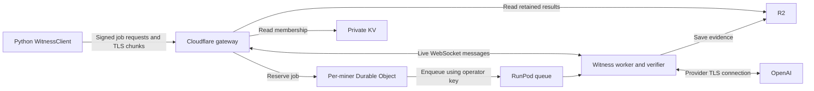

# Witness server release checklist

The witness has two deployment targets: a [Cloudflare gateway](../witness-gateway/README.md)
for job queueing and a [RunPod worker](../witness-server/README.md) for TLS capture
and verification.

## Release work

| Area | Required work |
| --- | --- |
| Artifacts | Build from a tagged commit, audit dependencies, include licences, and record gateway bundle, worker image, native verifier, verification-key hash, and compatible client version. |
| Membership | Deploy the gateway's one-minute Cron Trigger and confirm `membership_refreshed` logs for Finney subnet 17. The [chain reader](../witness-gateway/src/membership.py) publishes private KV snapshots and preserves their timestamps on failure. Authentication rejects snapshots or finalized blocks older than five minutes. Ten-minute refreshes, retries, and freshness tolerance remain separate pending policy work. |
| Cutover | Deploy matching client, gateway, and worker between generation rounds. Preserve Durable Object state and job allowances. |
| Generation phase | Set the gateway and worker to the active round. Close gateway access when generation ends. Retain public transcripts needed for validation. |
| Gateway access | Configure anonymous edge rate limits and test up to 250 miners with representative transcript sizes, queue delays, polling, and provider throttling. |
| Monitoring | Emit consistent events for membership refresh failures, worker failures, verification rejections, and unresolved usage, with an alert hook. |
| Competition accounting | Integrate recorded usage with the validator's allowance check. Charge all `input_tokens` at the model's input weight, including cached tokens, plus `output_tokens` at its output weight. Verify that changing only `input_tokens_details.cached_tokens` leaves the charge unchanged. |

## Deployment validation

Run the [local checks](../witness-server/README.md#local-checks), then test the exact
release artifacts through Cloudflare, RunPod, R2, and OpenAI. Include worker
interruption, storage failures, gateway restart, recovery, and a round-start burst.
Record artifact identities, configuration, and results together.

Preserve Durable Object namespaces and migration identifiers when deploying:
they contain the reservations that prevent duplicate jobs. Publish proof parameters
matching the client's pinned hashes.

The Python gateway preserves the `MinerAdmission` class, object names, stored
records, and `v1` migration. Local workerd checks cover its bundled sr25519
bridge, WebSockets, hibernation, alarms, JavaScript-written state, and the Python
client/worker transport contract. Local RunPod and evidence fixtures do not
establish Cloudflare → RunPod → OpenAI operation. The language migration does
not itself deploy the gateway or the scheduled membership reader.

Legacy behavior to validate during deployment: the pinned local Miniflare
runtime delays the miner's idle-alarm close notification in both the original
JavaScript gateway and Python. Local checks verify allocation retirement,
worker-side closure, and removal of both server sockets. Confirm prompt closure
at both clients in Cloudflare before opening the round; this migration preserves
the existing alarm and close policy.
