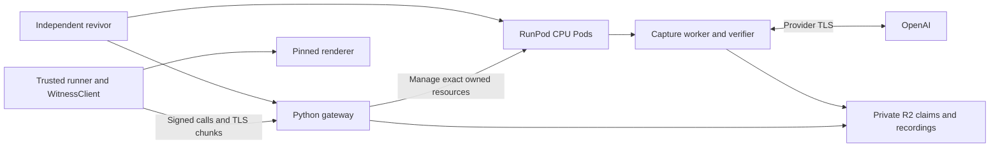

# Witness server release checklist

The release consists of the Python Pod gateway, capture worker, renderer,
verifier, client and trusted miner runner. The [Pod guide](../witness-gateway/PODS.md)
defines lifecycle, evidence, budgets and pinned runtime configuration.

## Integration inputs

Use `codex/witness-pod-gateway` for the gateway cleanup and
`codex/witness-render-integration` for the combined witness/renderer assembly.
Integrate a finished, committed assembly snapshot with its tested image manifest.
Keep earlier deployment manifests and tags immutable; pin the combined release
only after its own checks pass.

Reconcile the client generation API, recovery tests, Pod Dockerfile, Docker context
and current documentation when combining the branches. Retain the Pod allocation
and recording paths. The client wheel, miner runner, recording exporter and
replay code must agree on the same API and generation identity. Verify old saved
recordings with the intended compatible replay path before cutover.

## Release gates

| Area | Required evidence |
| --- | --- |
| Artifacts | Record a clean source commit/tag, immutable image digest, client wheel hash, runtime versions, dependency constraints, native verifier, proof-key hash, frozen pricing and renderer settings. Include licences and dependency audit results. |
| Image | Build from the Pod Dockerfile and its context allowlist. Verify all runtime roles, renderer readiness, proof-key identity and exclusion of credentials, local state and proving parameters. Record native versus emulated execution. |
| Client and runner | Run existing client, gateway, worker, verifier, renderer and miner-runner tests and strict type checks against the integrated snapshot. Check the packaged wheel, not only editable sources. |
| Recovery | Interrupt client/gateway connections before and after authorization, restart services and retry storage delivery. Recovery must use retained responses for started inference; unresolved usage remains unknown. Verify ownership and fencing of replacement attempts. |
| Replay | Native-verify every recording, replay twice with network access denied, compare output bytes and delivery order, and freshly recompute renders with the pinned renderer. Investigate timeout or pixel disagreements without relaxing validation. |
| Accounting | Use frozen pricing and exact recorded usage. Count cached input at the full input weight and reasoning within output once. Preserve failed attempts, possible dispatches and uncertain charges. |
| Membership and round | Check finalized membership refresh, fail-closed stale membership, hotkey ownership and nonce checks. Match the pinned round across runner, client and services; verify access closes at the generation deadline. |
| Lifecycle and capacity | Exercise gateway recovery, dormant/active/draining workers, lost create replies, duplicate resources and confirmed exact-ID deletion. Enforce configured compute ceilings using fresh RunPod inventory. |
| Operations | Configure TLS, stable hostname/revivor, private R2 permissions, spool persistence and bounded concurrency. Check representative miner bursts, backpressure, resource limits and failure diagnostics. |

## Deployment acceptance

After local checks, run the exact combined artifacts through ordinary RunPod Pods,
R2 and the authorized provider routes. Include gateway restart, worker loss,
network interruption, upload failure and recorded recovery. Local fixtures and
amd64 emulation validate their stated scope; they do not establish native RunPod
performance or deployed end-to-end acceptance.

Record wall time, active time, retries, actual concurrency, model-equivalent usage
and actual infrastructure costs separately. Preserve all inference responses,
identities, evidence and accounting. Stop only resources owned by the acceptance
run and confirm termination through RunPod.

Deploy matching client, runner and services between generation rounds. Preserve
existing R2 claims and recordings. Publish the accepted manifest and compatible
client artifact together after the release gates pass.
