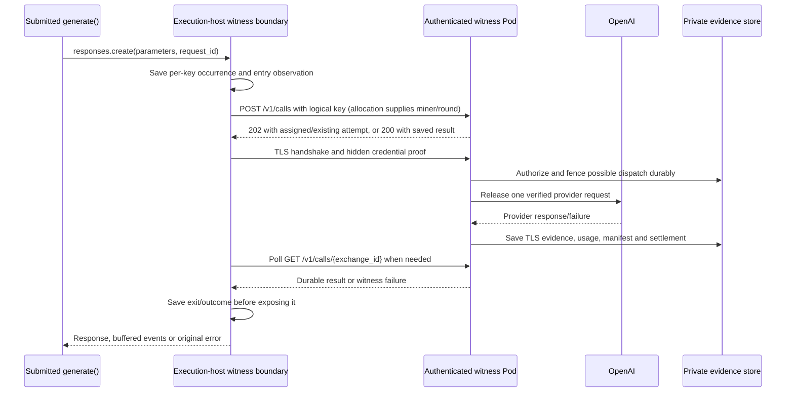

# Witness capture

An already issued key returns its retained result without provider inference.
Only proven non-dispatch permits another capture attempt. A lost dispatch
acknowledgement or partial authorized response remains uncertain.
