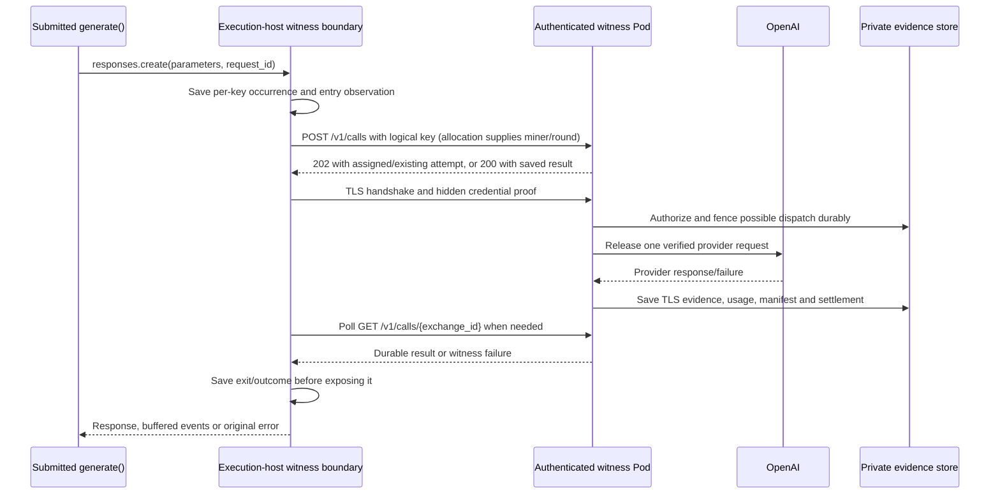

# Witness capture and replay



An already issued key returns its retained result without provider inference.
Only proven non-dispatch permits another capture attempt. A lost dispatch
acknowledgement or partial authorized response remains uncertain.

```mermaid
sequenceDiagram
    participant V as Validator execution host
    participant E as Trusted verified bundle
    participant M as Same submitted generate()
    V->>E: Verify capture TLS, bindings and frozen pricing
    V->>M: Same image, seed and reproducible renderer
    M->>E: Model call / stream operation
    E->>E: Match logical key + occurrence and causal observations
    E-->>M: Retained Response/event/error
    M-->>V: Final JavaScript or None
    V->>V: Compare output; charge distinct consumed calls
```

Unrelated round captures are not required by this execution. Replay never issues
inference, fills evidence gaps or treats unknown usage as zero. Boundary order
cannot control arbitrary Python scheduling; isolation and deterministic external
inputs remain execution-host prerequisites.
