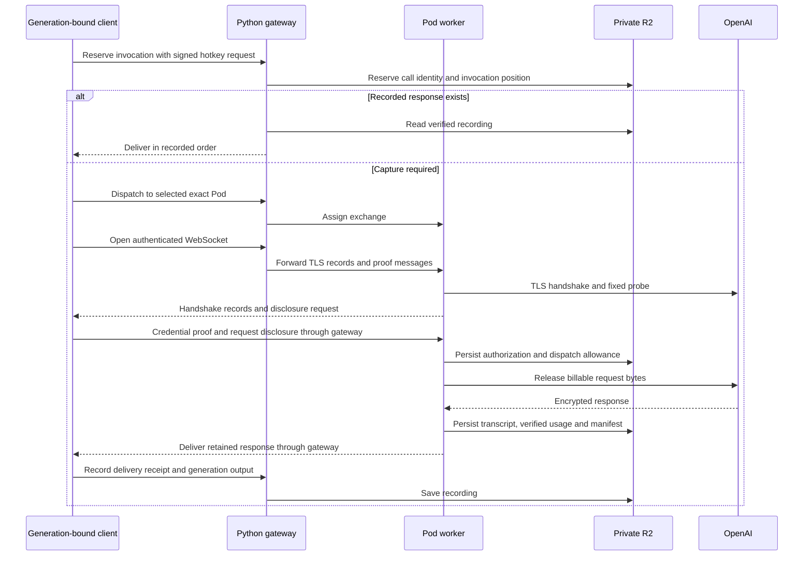
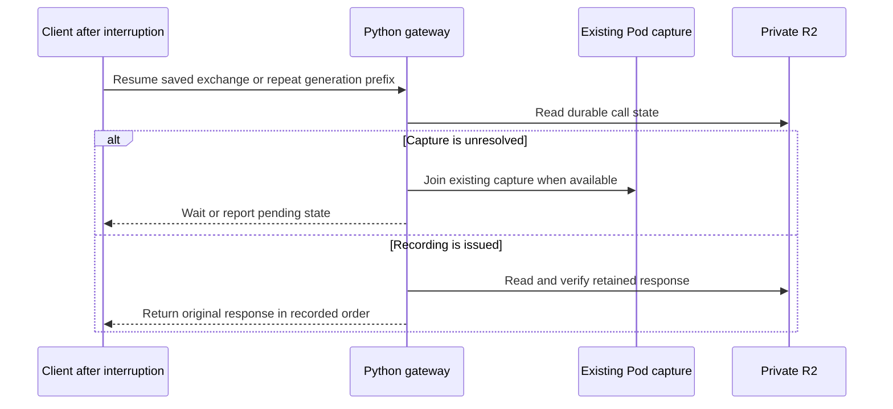

# Witness request and recovery sequence

The trusted runner binds miner code to frozen generation inputs. The Python
gateway authenticates the hotkey and coordinates ordinary CPU Pods. Durable R2
claims prevent duplicate provider dispatch; recordings preserve invocation and
delivery order.

The worker saves authorization before releasing billable bytes. After release,
provider capture and persistence continue independently of the miner connection.
Upload retries use the saved spool. A disconnected or timed-out client keeps the
same exchange and generation identity.

The revivor can replace a failed gateway while workers finish their captures.
RunPod is authoritative for Pod ownership and lifecycle; R2 retains inference
claims, attempts and usage. See [PODS.md](../witness-gateway/PODS.md) for fencing,
replacement and unresolved-usage rules.

Offline replay uses native-verified recordings and retained provider responses.
It checks request identity, invocation order, delivery order and generated output
without provider access. Renderer replay uses the pinned renderer and unchanged
validation rules.
