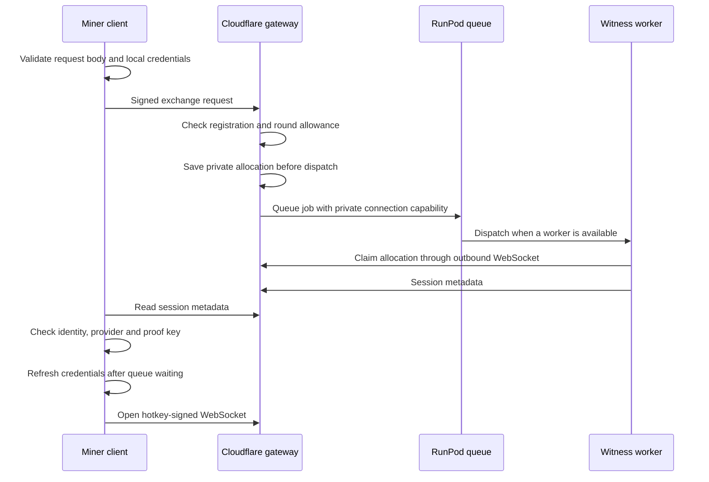
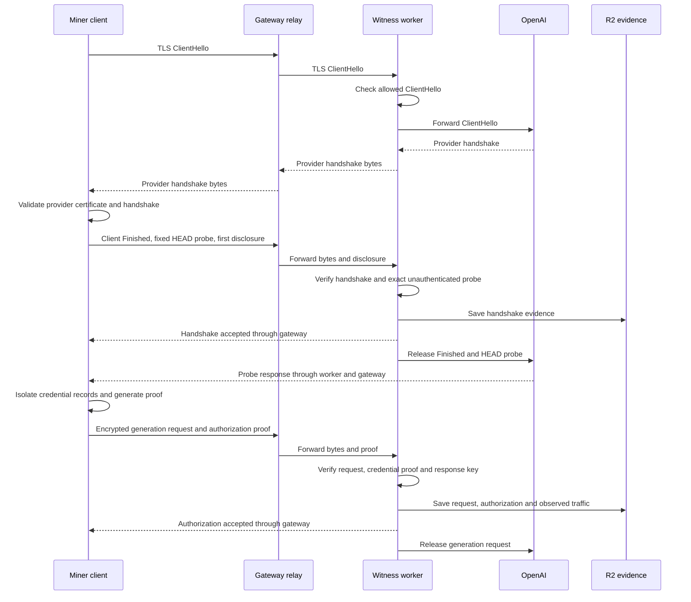
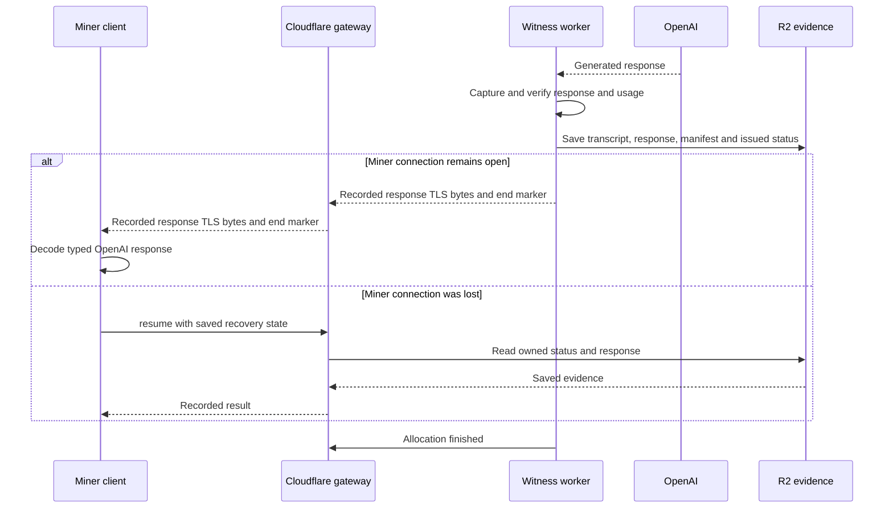

# Witness exchange

The miner runs `WitnessClient`. Cloudflare owns worker allocation and forwards
messages. A RunPod worker owns the provider connection, verification, and saved
evidence. R2 stores evidence under `rounds/<round>/<hotkey>/<request-id>/`.

## Allocation

The gateway pairs the two WebSockets. Encrypted OpenAI TLS bytes travel as binary
messages. Claims and acknowledgements travel as text messages. The client-to-gateway
and worker-to-gateway connections use their own TLS protection.

## Provider handshake and authorization

A disclosure supplies selected TLS record keys and metadata. The worker uses it
to decode the traffic it captured. Both disclosures happen before generation.

The credential's encryption key stays in the miner process. The native proof
binds the hidden credential records to the observed TLS connection. The worker
receives the response key before releasing the request, so capture can continue
without further miner disclosures.

## Capture and recovery

A broken live connection is not resumed as a TLS stream. `resume()` retrieves
an authorized result from retained evidence. An open connection that stays
silent after the status is `issued` is closed and retrieved the same way.
`release(exchange_id)` retires a stuck allocation, allowing a later `create()`
to queue another job. It does not reset the job allowance or cancel provider
capture already in progress.

The private allocation survives gateway restarts. Repeated queue calls keep the
same request ID. A worker capability can be claimed once, and a retired request
cannot accept a late worker. A new RunPod job may reuse a warm worker.

During validation, the validator lists evidence for the round and hotkey, runs
the submitted miner code, compares its outgoing GPT requests with the recorded
requests, and returns recorded responses instead of calling GPT.
