# Ordinary CPU Pod allocation

`pod_gateway` implements the allocation core for a Python witness gateway. It
uses ordinary RunPod CPU Pods and one private R2 JSON journal per miner, round,
and deployment. It does not change the existing TypeScript gateway or any live
resources. There is no public HTTP service in this slice.

## Acquire and replace

The authenticated caller supplies a canonical hotkey and the operator's active
round and deployment in a `Scope`. `Scope` checks encoding only; it does not
verify a signature, SS58 checksum, or subnet membership. Never construct it from
an unauthenticated request without those checks.

`Allocator.acquire(scope, start_id, replaces=...)` takes a new UUID for a
deliberate fresh session. Transport retries retain the UUID and `replaces` value.
The first session omits `replaces`; later sessions must name the current session.
An old UUID returns its retired record and cannot displace a newer session.

```mermaid
stateDiagram-v2
    [*] --> draining: save intent and revoke previous selection
    draining --> draining: capture/upload busy or deletion not confirmed
    draining --> creating: previous absent, inventory clear, CAS committed
    creating --> allocated: exact Pod identified
    creating --> creating: outcome unknown; inventory reads only
    creating --> rejected: explicit create rejection
    allocated --> lost: exact Pod GET returns 404
    allocated --> retired: accepted replacement
    rejected --> retired: accepted replacement
    lost --> retired: accepted replacement
```



Replacement first revokes the old journal selection. `WitnessControl.drain()`
must idempotently stop new work and acknowledge only after all paid capture and
evidence uploads finish. An unreachable Pod is not a successful drain. The core
then deletes that exact, identity-checked Pod and requires a subsequent GET 404
before sending the new create. Stopped/EXITED Pods still exist and do not count
as deleted. This ordering deliberately leaves a gap between Pods.

`allocated` means RunPod returned or inventory identified a Pod. It does not mean
the container is ready or allowed to serve. Images must be pinned by digest and
must honor `WITNESS_BOOT_MODE=dormant`. The future listener must authenticate its
private control channel, fence dispatch atomically with drain, and require the
current exact Pod ID. `selected()` is an internal selection check, not an
authentication mechanism or a complete dispatch protocol.

## Crash recovery without SQL

The journal key is
`pod-gateway/v1/<deployment>/<round>/<full-hotkey>.json`. It retains all start IDs
for the round, including retired ones. Writes use R2's atomic `If-None-Match: *`
or `If-Match: <ETag>` preconditions. A unique revision distinguishes a committed
write when its acknowledgement is lost. An unconfirmed write never authorizes
a provider side effect. The client disables implicit SDK write retries.

The `draining -> creating` write grants exactly one caller permission to send
POST `/v2/pods`. An already persisted `creating` record grants no such permission,
even if inventory is empty. This includes a crash after the journal write but
before POST: recovery prefers a stuck intent over a duplicate billable Pod.

`reconcile(scope)` lists every inventory page and matches the full deployment,
round, hotkey, start ID, spec fingerprint, pinned image, and exact name. One
matching Pod is adopted. Multiple candidates or stray owned Pods block progress.
Nothing is selected from ambiguous inventory, and this core does not delete
orphans automatically. An uncertain create cannot be replaced with a new UUID
until the original Pod is identified. Empty inventory alone cannot resolve it.

Pod names contain readable deployment/round prefixes, a hotkey hash, and the
start UUID. Full values are in environment markers, avoiding dependence on
truncated names or hash uniqueness. Names are correlation data, not credentials.
The adapter strips other environment variables before returning provider data;
journals do not contain operator secrets. Keep this prefix private and separate
from existing evidence and usage objects. Never delete journals while requests
may still finish. Replacing a Pod does not reset inference allowances or erase
evidence.

History is bounded at 1,024 starts per miner per round (configurable downward),
and journals at 1 MiB. Reaching either bound fails closed without evicting retry
records. These are storage bounds, not inference budgets or a capacity queue.

## Integration boundary

The core accepts injected R2, RunPod, and drain adapters. Production HTTP clients
must use `RunPodClient.http_client()` or an equivalent client with no implicit
POST retries; keep its lifetime scoped and close it on shutdown. RunPod errors
retain HTTP status and `Retry-After`, without copying error bodies or secrets.
There is no retry loop or automatic capacity fallback.

Still required before cutover:

- Authenticated HTTP routes, existing hotkey/membership checks, and client wiring.
- Persistent Pod witness listener, dormant startup, readiness, and authenticated
  drain, reusing the verifier, paid-capture, and evidence behavior.
- Idle expiry after at least 30 minutes with no active capture or pending upload,
  with provider termination confirmed by the control plane.
- Independent gateway recovery and scoped orphan cleanup. A replacement gateway
  must fence the old gateway before taking over serving traffic.
- Round-wide usage/budget enforcement and capacity admission. No FIFO or priority
  queue is implemented here.

Do not deploy this core as a standalone gateway or point the existing witness
image at it. The missing listener and authentication are required for cutover.

## Offline validation

From `witness-gateway`, use Python 3.11+ with `requirements.txt`, pytest, and mypy:

```sh
python -m pytest -q
python -m mypy
```

All provider and R2 traffic is simulated, and tests forbid socket connections.
Coverage includes ambiguous creates, crash windows, competing retries, ETag
conflicts, delayed termination, pending captures, identity mismatches, inventory
pagination, secret redaction, and stale IDs.

API references: [RunPod v2 contract](https://api.runpod.io/v2/openapi.json),
[R2 conditional PutObject](https://developers.cloudflare.com/r2/api/s3/api/), and
[R2 consistency](https://developers.cloudflare.com/r2/reference/consistency/).
