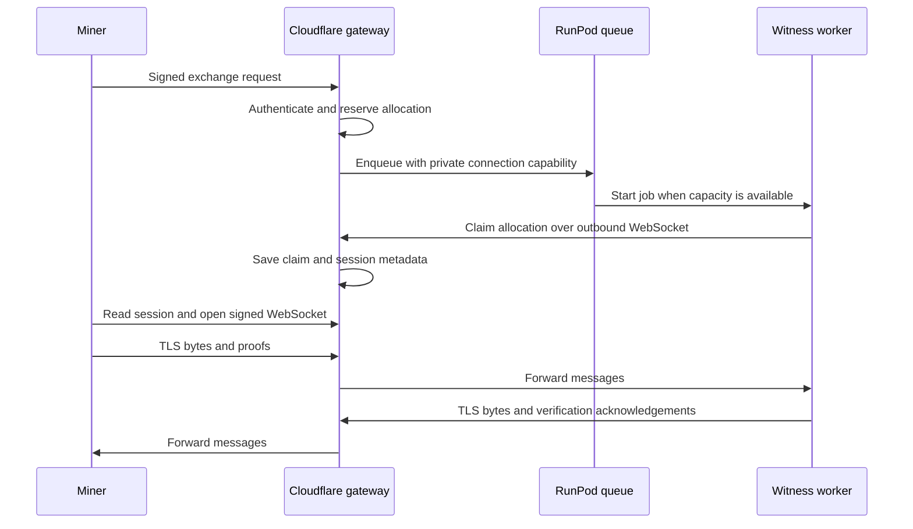

# Witness gateway

A public TypeScript Cloudflare Worker authenticates registered Bittensor miners, queues
RunPod jobs, and connects each miner to its assigned witness worker. A Durable
Object per round and hotkey owns allocation state and the infrastructure allowance.

Both the miner and the RunPod worker open outbound WebSockets to Cloudflare.
The gateway forwards bounded messages between them. The witness performs TLS
verification and writes evidence to R2. Retained responses stream from R2 through
an authenticated download route.



## Allocation rules

- Each miner has one current request, including queue waiting.
- Repeating the same request ID returns its existing state. Different parameters
  under that ID are rejected.
- A reservation consumes one job from `MAX_JOBS_PER_MINER` before dispatch.
  Restarts, releases, and replacements do not reset this count.
- The worker capability is private and single-use. Duplicate RunPod deliveries
  and workers arriving after replacement cannot attach.
- `POST /release/<ID>` retires that allocation. It is safe to repeat. A subsequent
  request can queue another worker. `/run` also accepts a signed `replace` ID
  to reserve the replacement in the same operation.
- Closing a live connection retires the allocation. A worker already capturing
  OpenAI continues saving evidence independently of that connection.

A RunPod job may reuse a warm worker. A new allocation does not promise a different
physical machine. Each allocation lasts for one OpenAI exchange.

## Public API

The Python `WitnessClient` handles these routes:

| Route | Purpose |
| --- | --- |
| `POST /run` | Reserve and queue a signed exchange. |
| `GET /status/<ID>` | Read allocation state, deadline, and worker session metadata. |
| `POST /release/<ID>` | Retire this miner's allocation. |
| `GET /exchanges/<ID>/connect` | Upgrade to the miner's live WebSocket. |
| `GET /exchanges/<ID>/progress` | Read recorded witness progress. |
| `GET /exchanges/<ID>/response.sse` | Download a retained response. |

`POST /run` and `GET /status/<ID>` return the same allocation snapshot:
`round`, `hotkey`, `exchange_id`, `queue_state`, `deadline`, and `session`.
The session is `null` until the worker reports its metadata. The client polls
status every five seconds and connects when the allocation is `connected` and
session metadata is present. Retired or finished allocations cannot be connected,
even if their session metadata remains available.

Miner HTTP requests and WebSocket upgrades require a fresh `btauth/1` signature
over method, path, body hash, nonce, hotkey, and receiver `404-witness`. Authentication
is valid for ten seconds. Used nonces are rejected, and ownership is checked for
every route. Clock synchronization is required.

The signed job contains `operation`, `hotkey`, `receiver`, `exchange_id`, `deadline`,
`provider`, and an optional `replace` ID, in that order. `provider` is `api` or
`codex`. The gateway assigns the active round and bounds the deadline by `ROUND_END`.
The worker verifies the signed job and its configured round before claiming.

`GET /workers/<round>/<hotkey>/<ID>` is the worker's WebSocket upgrade route. Its
Bearer capability comes from the private RunPod job. It is never returned to the
miner or stored in public transcripts. The operator's RunPod API key stays in
Cloudflare's encrypted secrets.

## Live transport and recovery

Binary WebSocket messages carry TLS bytes in chunks of at most 256 KiB. Text
messages carry the two verification claims, acknowledgements, and an explicit
end marker. Each TLS direction is limited to 16 MiB. Claims are limited to 2 MiB
each. The gateway also caps total messages and bytes per connection. Socket
attachments retain counters across Durable Object hibernation.

The gateway holds no live transcript buffer. Each endpoint receives messages in
WebSocket order. A broken socket ends that live TLS exchange. The miner can use
`resume()` for saved evidence or `release()` followed by `create()` for a new
attempt. Paid requests are not automatically repeated.

If the RunPod enqueue reply is lost, the allocation remains `uncertain`. A process
interruption during dispatch can leave it `submitting`. Retrying the same ID does
not dispatch again. A worker with the original capability can still attach, or
the miner can release the allocation. Late dispatch replies cannot restore a
retired request. Network calls to RunPod happen outside the state lock.

The witness's request, response, and usage remain its responsibility. Allocation
state uses `submitting`, `queued`, `uncertain`, `connected`, `finished`, and `retired`.
A competition **submission** is separate from an exchange allocation.

## Configuration and deployment

Both Workers run TypeScript compiled to ES modules, with explicit protocol and
storage types and Cloudflare's native bindings. The 30,000 ms CPU limit and
existing Workers Paid controls remain in place.

[crypto.mjs](src/crypto.mjs) calls the existing Polkadot SS58, sr25519, and
Substrate storage-key functions. The build statically imports the same WASM
binary. A separate TypeScript Worker refreshes membership and shares the
private KV namespace with the gateway.

Set [wrangler.jsonc](wrangler.jsonc) for the gateway and
[wrangler.membership.jsonc](wrangler.membership.jsonc) for membership refreshes:

The checked-in configuration uses the fixed round `test-0` and live Finney subnet
17 membership. Its availability is independent of competition phases. RunPod
must use `WITNESS_ROUND=test-0`; signed request deadlines still limit each job.

`TEST_HOTKEY` optionally admits one operator-controlled hotkey without subnet
registration, only in `test-0`. It still requires valid signatures and follows
the same membership freshness, replay, ownership, rate and job limits. Remove or
empty the variable to disable it. Regular miners continue to use the live Finney membership snapshot.

1. Bind the same private KV namespace as `REGISTRY` in both Workers. Bind the
   witness evidence bucket as `TRANSCRIPTS` only in the gateway.
2. Set `ROUND`, `RUNPOD_ENDPOINT`, `MAX_JOBS_PER_MINER`, and `ROUND_END` in Unix
   seconds on the gateway. Set the same round as `WITNESS_ROUND` on RunPod. Both
   Workers use Finney subnet 17 (`NETWORK=finney`, `NETUID=17`). Set the HTTPS
   `SUBTENSOR_RPC_URL` only on the membership Worker.
3. Store the endpoint-restricted RunPod key on the gateway with
   `npx wrangler secret put RUNPOD_API_KEY`.
4. Keep the configured ten-minute Cron Trigger on the membership Worker. It
   reads registration from a finalized Finney block and replaces the private KV
   `membership.json` snapshot. It has no public route or RunPod credentials.
   The gateway has no Cron Trigger. Refreshes also run while the round is closed.
5. Run `npm run build`, then dry-run and deploy both configurations:

   ```sh
   npx wrangler deploy --config wrangler.membership.jsonc --dry-run
   npx wrangler deploy --dry-run
   npx wrangler deploy --config wrangler.membership.jsonc
   npx wrangler deploy
   ```

   Check for a `membership_refreshed` log on the membership Worker before opening
   access. Cron Trigger changes can take up to 15 minutes to propagate.

The build bundles [worker.ts](src/worker.ts) and
[membership.ts](src/membership.ts) into separate entry points in `dist`.
Wrangler uploads only the selected bundle and its static WASM module. No
Python runtime or FFI is deployed. The Python client and RunPod worker remain
unchanged. `requirements.txt` is for local Python diagnostic helpers.

Each miner request checks this cached registration list. Chain reads run on the
schedule, independently of miner traffic. Registration changes become visible
after refresh and KV propagation. A failed refresh preserves the previous
snapshot and its timestamps and emits `membership_refresh_failed`. The gateway
accepts the last successful snapshot for up to 48 hours. If either the snapshot
or its finalized block exceeds that age, it returns `membership_unavailable`.
The membership Worker only publishes a snapshot when its finalized block is at
most five minutes old. Failed refreshes never extend the saved snapshot's lifetime.

Control requests have a per-miner burst of 20 and refill at two requests per
second. New allocations have the persistent per-round job allowance. These
limits govern infrastructure usage. Token accounting belongs to validation.

The request deadline bounds total queue and execution time, up to seven days.
RunPod's endpoint execution timeout separately caps time on a worker; the gateway
does not override it. Keep that timeout enabled (40 minutes on the test endpoint).
The worker also limits miner setup before generation. `ROUND_END=0` closes
gateway access. Existing connections close at their assigned deadline. Preserve
the Durable Object namespace and migration history across deployments.

Keep the Worker name, `MinerAdmission` class, `MINERS` binding, and `v1` SQLite
migration. Object names remain `<round>/<hotkey>`. Storage keys `job/<ID>`,
`nonce/<nonce>`, `current`, `count`, and `rate`, job field names, alarms, and socket
attachments retain their existing formats. The TypeScript migration requires no
Durable Object migration entry or data reset.

Deploy the client, gateway, and RunPod image together between generation rounds.
The protocol uses live sockets throughout; public R2 objects are evidence.

## Checks and reading order

Read [auth.ts](src/auth.ts), [membership.ts](src/membership.ts),
[worker.ts](src/worker.ts), then
[the exchange sequence](../witness-client/SEQUENCE.md).

Use Node 22.13+ and Python 3.13 in the witness-client test environment for the
unchanged Python transport tests. [models.ts](src/models.ts) describes protocol
and persisted records; [runtime.ts](src/runtime.ts) contains bounded reads,
response helpers, hashing, and the existing state-lock policy. `npm run check`
builds the bundles, generates binding/runtime types from both Wrangler configs,
and runs strict TypeScript checking. Generated types stay in ignored build
directories. The required RunPod secret name is declared in the gateway config;
its value remains an encrypted Cloudflare secret.

```sh
npm ci --ignore-scripts --no-audit --no-fund
npm run check
PYTHON=/path/to/test-environment/bin/python npm test
```

Tests use real sr25519 signatures, Cloudflare's local `workerd` runtime, persistent
Durable Objects, chain RPC fixtures, and a RunPod stub. They cover registration
changes, failed refreshes, stale membership, duplicate dispatch, replacement,
restarts, ownership, disconnected workers, live WebSocket framing, and 250
simultaneous miners. The burst test measures local gateway admission, not cloud
throughput.

Migration checks seed existing records through the previous Python storage conversion, interrupt dispatch,
exercise deadline alarms, and verify actual hibernation with retained socket
counters. A local HTTPS/WSS test runs the unchanged synchronous `GatewayClient`
and `WorkerChannel`, then exercises `WitnessClient.resume()` against fixture R2
evidence. It sends fixture transport bytes and claims, not an OpenAI request or
a native cryptographic proof. It requires OpenSSL and the built witness client.

A small Python fixture exists only in the local storage migration test. It uses
the previous Worker's `to_js(..., dict_converter=Object.fromEntries)` conversion
to verify compatibility of identity, nonces, capabilities, alarms, and allowances.
It is never included in either deployment. Wrangler's dry run checks packaging;
the release checklist's Cloudflare → RunPod → OpenAI validation establishes the
live path. Check actual scheduled invocations and a fresh KV snapshot as well
as the configured cron, since scheduler activation can fail independently of
the application runtime.

[client.py](client.py) is a low-level queue diagnostic. Miner applications use
`WitnessClient`. Deployment validation is tracked in the
[server release checklist](../docs/witness-server-release-plan.md).
